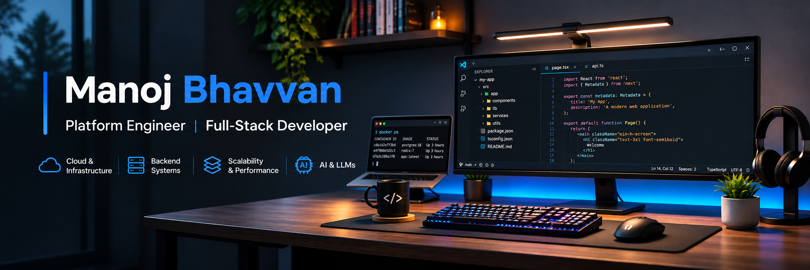

 

  

  

  Building scalable applications, reliable backend systems, and cloud-powered solutions.

---

## 👨‍💻 About Me

I'm a Platform Engineer passionate about building scalable web applications, designing reliable backend systems, and solving real-world engineering problems.

I work across frontend, backend, and cloud infrastructure, with experience in modern web platforms, API integrations, distributed systems, and application performance optimization.

- 💻 Building applications using Next.js, React, Node.js, and Python.
- ☁️ Working with Microsoft Azure, Docker, serverless functions, and cloud infrastructure.
- ⚡ Interested in system design, distributed systems, caching, and performance engineering.
- 🤖 Exploring AI/ML, LLMs, and practical applications of intelligent systems.
- 📫 Reach me at **[manojbhavvan124@gmail.com](mailto:manojbhavvan124@gmail.com)**

---

## 💻 Tech Stack

**Languages**

**Frontend Development**

**Backend Development**

**Cloud, DevOps & Infrastructure**

**Azure Services**

**Databases, Caching & Search**

**AI & Machine Learning**

**Monitoring & Tools**

---

## 🏆 Certifications

- [Microsoft Certified: Azure Developer Associate (AZ-204)](https://learn.microsoft.com/en-us/users/manojbhavvan-3462/credentials/2a5c4f629c4a68f9)

---

## 🌐 Connect With Me

  
  
  

  <i>Building, learning, and improving one commit at a time.</i>

  

